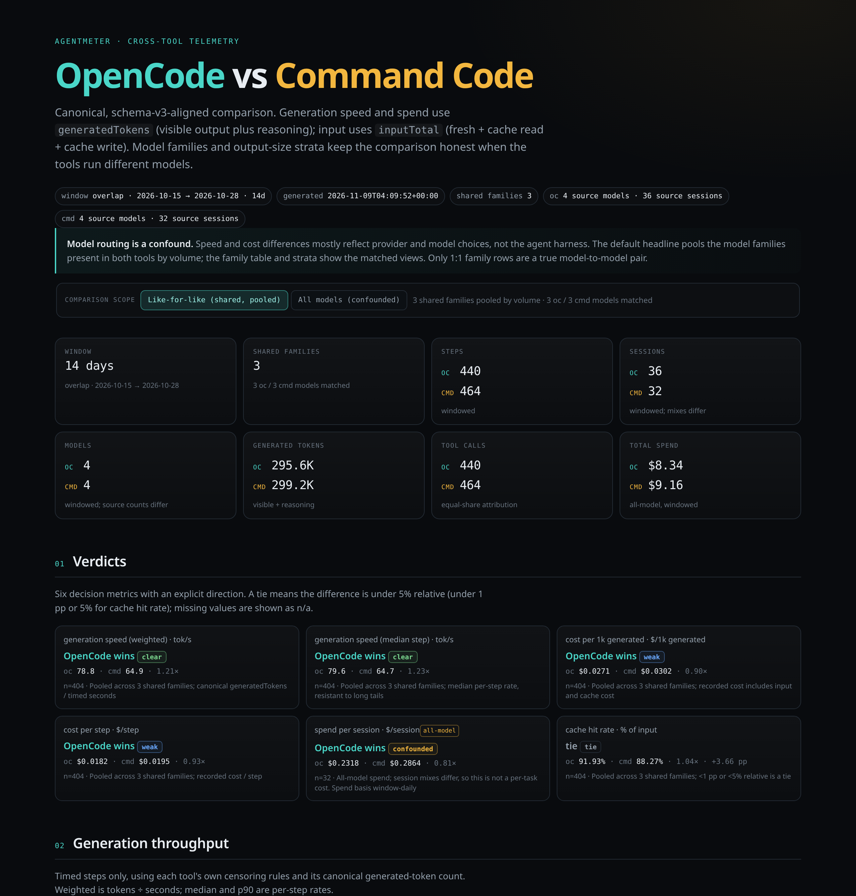

# AgentMeter

AgentMeter is one local Go binary that answers where your tokens, money, and
wall-clock time went across Command Code, OpenCode, Muse, and DeepSeek
Harness (`dsh`).

Each tool writes a different local session store. AgentMeter reads those
stores read-only, rebuilds per-step throughput, tokens, cache, reasoning where
recorded, cost, tool time, and session health on one schema, and renders
filterable HTML plus a compact terminal summary. `agentmeter compare` puts any
two tools on that schema and names the faster or cheaper side.

Four claims support that answer:

- Coverage: one view across four tools, normalized to schema v3.
- Comparison: any pair, like-for-like where model families overlap, with a
  named winner, a confidence label, and the caveat attached.
- Privacy: local, read-only, offline; no prompts, assistant text, tool
  arguments, or file contents are read or emitted.
- Trust: builders and independent audits fail closed on a broken invariant.



## Quick start

Precompiled archives are the primary distribution. Download the matching
`agentmeter-<version>-<os>-<arch>.tar.gz` (or `.zip` on Windows), verify it
against `checksums.txt`, extract it, and put `agentmeter` on `PATH`. Each
archive contains `LICENSE`, `NOTICE`, `THIRD_PARTY_NOTICES.md`, the verbatim
third-party license texts under `third_party/licenses/`, `README.md`, and
`version.json`. No Python, NumPy, or Go is needed to run.

```bash
tar -xzf agentmeter-<version>-linux-amd64.tar.gz
# Windows: unzip agentmeter-<version>-windows-amd64.zip
```

Source install:

```bash
go install github.com/jadmadi/agentmeter/cmd/agentmeter@latest
```

Build from a clone:

```bash
git clone https://github.com/jadmadi/agentmeter
cd agentmeter
./build.sh --all        # six archives + version.json + checksums.txt
./build.sh              # native release + install to ~/.local/bin
```

`./build.sh --target OS/ARCH` writes one bare binary for local use. Go 1.26+
is the only build requirement.

## Run

```bash
# Command Code
agentmeter cmd --serve
agentmeter cmd --watch   # keep serving and rebuild when sources change

# OpenCode
agentmeter oc --serve
agentmeter oc --watch    # keep serving and rebuild when the store changes

# Muse
agentmeter muse --serve
agentmeter muse --watch  # keep serving and rebuild when sources change

# DeepSeek Harness
agentmeter dsh --serve
agentmeter dsh --watch   # keep serving and rebuild when sources change

# Cross-tool comparison
agentmeter compare                      # oc-cmd over default live sources
agentmeter compare oc-muse              # explicit pair alias
agentmeter compare oc-dsh               # OpenCode vs DeepSeek Harness
agentmeter compare data/oc data/cmd     # positional inputs
agentmeter compare --oc data/oc --cmd data/cmd --serve
agentmeter compare --cmd data/cmd --muse data/muse --serve
agentmeter compare --oc data/oc --dsh data/dsh --serve
agentmeter compare --oc ~/.local/share/opencode/opencode.db \
  --cmd ~/.commandcode/projects --watch
```

`command-code`, `opencode`, and `deepseek` are accepted aliases for `cmd`,
`oc`, and `dsh`.

`--serve` builds once and serves that snapshot. `--watch` implies `--serve`,
polls the source, and rebuilds the static files when a change is detected;
refresh the browser tab to see the new report. Default output is `./data/cmd`,
`./data/oc`, `./data/muse`, `./data/dsh`, and `./data/compare`. Each command
writes a static `index.html` that loads its local JSON/JS data files, then
optionally serves the report on `127.0.0.1`.

## What you get

### Per-tool reports

Each report covers throughput, tokens, cache, cost, session span, per-model
timed coverage, output-size strata, session health, and the tool mix that
produced the work. Reasoning splits appear where the source records them:
OpenCode, Muse, and DSH separate reasoning from visible output; Command Code
folds reasoning into `outputTokens`, so its report shows no separate reasoning
figure. OpenCode splits session time into active and idle; Command Code, Muse,
and DSH report session span without that split.

The terminal summary is compact. The HTML page is static and filterable,
loads its local `telemetry-data.js`, and makes no external requests.

### Cross-tool comparison

`agentmeter compare` accepts a pre-built schema v3 report directory or file
for either side, or the tool's live source: an OpenCode SQLite store, or a
Command Code, Muse, or DSH session root. Any two of the four tools can be
compared: `oc-cmd`, `oc-muse`, `oc-dsh`, `cmd-muse`, `cmd-dsh`, and
`muse-dsh`. Sides are arranged in canonical tool order and `meta.pair`
records which pair a document compares. It writes `comparison-data.json`,
`comparison-data.js`, and `index.html`.

The default headline is like-for-like: it pools the model families present in
both tools by volume, with shared-family speed, cost, and strata. Family rows
show the model match (side A:side B); only 1:1 rows are a true model-to-model
pair, while N:1 and 1:N rows pool provider variants. `--all-models` switches
the headline to the all-model aggregate, which is context rather than a
harness verdict.

The terminal report names the winner and spells out the advantage (for
example, "<Tool> N× faster" or "<Tool> N× cheaper"), so cost ratios never need
to be inverted. The JSON keeps raw side A / side B ratios; speed ratios above
1 favor side A, cost ratios below 1 favor side A. Ties are under 5% relative
(cache: under 1 pp or 5% relative). The comparison also shows family/model
counts separately, `$ / 1M input`, per-session spend, low-sample and outlier
flags, timed coverage, and the explicit caveat that provider/model routing
dominates speed and cost differences.

## Privacy

- Session titles are included by default. Pass `--no-titles` to omit them.
  (Muse titles come from the session index; without it, session ids are
  shortened.)
- Project basenames are the default; `--full-paths` is opt-in.
- Generated JSON/JS and the HTML page can still contain session titles and
  project names. Review before sharing.
- No prompts, assistant text, tool arguments, or file contents are read or
  emitted.
- The OpenCode store is opened read-only.

## Correctness

Schema v3 validation runs inside every builder, and the comparison builder
rejects a non-v3 input. A wrong-length step tuple, totals that disagree with
model, step, or daily rows, tool shares that do not sum to 1, or a non-finite
value stops the build before a report is written.

```bash
# Go tests (includes Python-oracle parity checks when available)
go test ./...

# Full gate: Go build/tests + Python oracle tests + fixture audits
./check.sh
```

The committed fixtures run 615 Command Code and 1,938 OpenCode audit
assertions; `./check.sh` fails on any mismatch. The Python reference
implementation and audits live under `command-code-telemetry/py/` and
`opencode-telemetry/py/`. They are a differential oracle, not the supported
user path; the Go implementation is the release target.

Muse and DSH are Go-only for now. Both enforce the same schema v3 contract
(fail-closed on every invariant) and `check.sh` pins their fixture values, but
their differential oracles and independent audits are still to come.

The comparison engine consumes those validated reports. Its own tests cover
window intersection, family matching, output-size strata, partial metrics
(Command Code has no per-step wall clock; Muse measures per-call durations but
no active/idle split), deterministic output, and report-vs-live ingestion;
`check.sh` also builds and asserts a comparison from the committed fixtures,
plus both Muse pairs.

See [`CONTRACT.md`](CONTRACT.md) for field definitions, censoring, attribution,
spend, and the live-source watermark.

## Reference

### Commands and aliases

```text
agentmeter cmd      Command Code (alias: command-code)
agentmeter oc       OpenCode (alias: opencode)
agentmeter muse     Muse session telemetry
agentmeter dsh      DeepSeek Harness (alias: deepseek)
agentmeter compare  side-by-side two-tool comparison
agentmeter version  version, commit, build date, license, and source
agentmeter help     top-level help; agentmeter help <topic> for one command
```

### Common flags

```text
--models LIST    comma-separated, substring model filter
--since DATE     inclusive local date, YYYY-MM-DD
--until DATE     inclusive local date, YYYY-MM-DD
--out DIR        output directory
--no-titles      omit session titles
--full-paths     keep full project paths
--serve          build once, serve the report, and open it
--watch          watch sources, rebuild, and serve (implies --serve)
--port N         serve port (default 8000)
--no-open        do not open a browser
--json           print telemetry data to stdout (report files still written)
```

### Per-tool flags

Command Code adds `--root` (default `~/.commandcode/projects`). Muse adds
`--root` (default `~/.local/share/muse/sessions`), reading Muse's own session
event logs plus the optional `session-index.db` labels. DSH adds `--root`
(default `~/.dsh`), reading `.jsonl.zstd` and `.jsonl` session logs plus
optional `storages/session_projcache` metadata.

OpenCode adds `--db` (default `~/.local/share/opencode/opencode.db`),
`--baseline` for the pace-index window, and the timing thresholds
`--min-tokens` (20), `--min-seconds` (0.5), `--max-seconds` (300),
`--min-rate` (3), and `--max-rate` (400).

### Compare flags and inputs

```text
--all-models     headline uses all models instead of shared families
--json           print comparison-data.json instead of the human summary
--no-color       disable ANSI color
```

`compare` adds `--oc` (report or OpenCode store), `--cmd` (report or session
root), `--muse` (report or session root), and `--dsh` (report or DSH
home/sessions root); it shares `--out`, `--serve`, `--watch`, `--port`, and
`--no-open`.

Tool values are optional: omit them (or pass a tool flag alone) to use the
tool default. Without an alias, set tool flags select the pair; a single flag
pairs that tool with the first `oc-cmd` default not already present.
Positional inputs fill the pair sides in order, and pair aliases (`oc-cmd`,
`oc-muse`, `oc-dsh`, `cmd-muse`, `cmd-dsh`, `muse-dsh` plus `-vs-`, `_vs_`,
and `+` spellings in either direction) are accepted. Run
`agentmeter cmd --help`, `agentmeter oc --help`, `agentmeter muse --help`,
`agentmeter dsh --help`, or `agentmeter compare --help`.

### Exit codes

| Code | Meaning               |
| ---- | --------------------- |
| 0    | success               |
| 1    | data or runtime error |
| 2    | usage error           |

No exit code 3 is currently defined.

## Development

The Go module uses the standard library plus `modernc.org/sqlite` (pure Go, no
CGO). The Python reference and audits are optional for users; contributors
need `python3 -m pip install -r requirements-dev.txt` only for the oracle
gate.

`./check.sh` fails closed if Go, NumPy, or pytest is missing. It also runs
`scripts/check-licenses.sh`, which verifies SPDX headers and the third-party
manifest.

`./build.sh --all` cross-compiles the six release targets with `CGO_ENABLED=0`
and writes license-bearing archives plus `dist/version.json` and
`dist/checksums.txt`. The repository intentionally has no GitHub Actions
workflow; see [`RELEASING.md`](RELEASING.md) for the manual release runbook.

## Layout

```text
cmd/agentmeter/           one binary: cmd / oc / muse / dsh / compare / version
internal/                 shared stats, contract, JSON, emit, sources, reports
  compare/                comparison model, deltas, normalization, CLI, web
  report/compare/         comparison builder and input ingestion
command-code-telemetry/
  go/                     Command Code Go adapter
  py/                     Python reference builder + audit
  web/                    shared HTML renderer
  testdata/               fixture + expected report
opencode-telemetry/
  go/                     OpenCode Go adapter
  py/                     Python reference builder + audit
  web/                    shared HTML renderer
  testdata/               golden reports
muse-telemetry/
  go/                     Muse Go adapter
  web/                    shared HTML renderer
  testdata/               fixture (Python oracle is Phase 2)
dsh-telemetry/
  go/                     DeepSeek Harness Go adapter
  web/                    shared HTML renderer
  testdata/               fixture
tests/                    Python oracle and parity tooling
CONTRACT.md               schema v3 analytics contract
AGENTS.md                 agent runbook + working contract
project.jsonc             project catalog metadata for jadmadi.net
build.sh                  native/cross-platform release builds + install
check.sh                  full correctness gate
requirements-dev.txt      Python oracle only (pytest + numpy)
```

## Security

See [`SECURITY.md`](SECURITY.md) for supported versions and private reporting.

## Contributing

See [`CONTRIBUTING.md`](CONTRIBUTING.md). Run `./check.sh` before sending a PR.

## License

AGPL-3.0-only. See [`LICENSE`](LICENSE), [`NOTICE`](NOTICE), and
[`THIRD_PARTY_NOTICES.md`](THIRD_PARTY_NOTICES.md). The release archives include
these files and the verbatim texts under `third_party/licenses/`.

Copyright (C) 2026 Jad Madi · [@jadmadi](https://x.com/jadmadi).

If you run a modified version as a network service, the AGPL requires offering
the corresponding source to its users. The HTML reports link to the upstream
source; if you deploy a modified version, point that link at your source.
